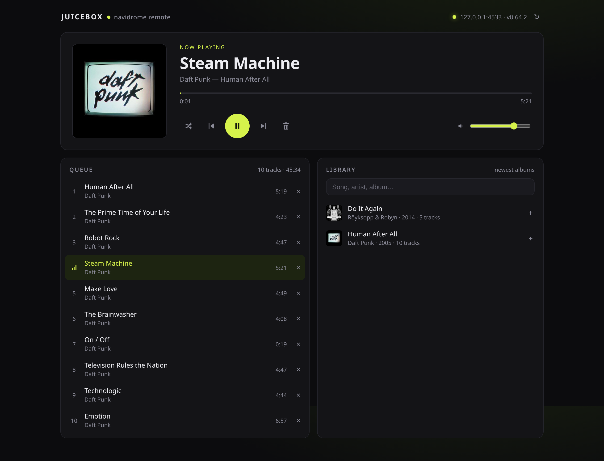

# Juicebox

Remote control for [Navidrome](https://www.navidrome.org/)'s **jukebox mode**: queue music, skip, pause and set the volume on the box that actually has the speakers, from any browser on the network.

Navidrome's own web UI cannot drive the jukebox — the feature is only reachable through the Subsonic `jukeboxControl` endpoint. Juicebox is that remote.



## Status

Proof of concept: the whole control surface works end to end against a real Navidrome + mpv jukebox. The UI is deliberately plain — it exists to prove the plumbing. Feature work comes next.

## Quick start

```sh
npm install
./scripts/sandbox-up.sh     # throwaway Navidrome + 15 test tracks, :4533
./scripts/audio-dev.sh      # jukebox audio -> this machine's speakers
npm run dev                 # api :3101 + web :3100
```

Open <http://127.0.0.1:3100>.

`npm run dev` runs two processes: the API server (`server/`, holds the Subsonic credentials) and Vite. `npm run build && npm start` serves the built app and the API from `:3101` alone.

## How it talks to Navidrome

Browser → Juicebox API → Subsonic `/rest/jukeboxControl` → Navidrome → `mpv` on that host.

- Credentials stay server-side; the browser only sees Juicebox's own JSON.
- Auth is Subsonic salted token (`t=md5(password + salt)`), so the password never travels.
- There is no push channel in the Subsonic API, so the UI polls `/api/state` once a second.
- One queue, one device: Navidrome's jukebox has a single global playback queue. `Jukebox.AdminOnly` decides who may drive it.

See [docs/ARCHITECTURE.md](docs/ARCHITECTURE.md) for the decisions and [docs/API.md](docs/API.md) for the exposed surface.

## Configuration

Copy `.env.example` to `.env` and point it at the Navidrome you want to control:

| Variable | Default | Meaning |
| --- | --- | --- |
| `NAVIDROME_URL` | `http://127.0.0.1:4533` | Navidrome base URL |
| `NAVIDROME_USER` | `admin` | User with jukebox permission |
| `NAVIDROME_PASSWORD` | `juicebox` | That user's password (sandbox default) |
| `PORT` | `3101` | Juicebox API port |

## Layout

```
server/          API + Subsonic client (plain ESM Node, no build step)
src/             React UI (Vite + TS)
sandbox/         throwaway music/data mount points for the dev instance
scripts/         sandbox-up.sh — compose + seed music + create admin + scan
docker-compose.yml   the throwaway Navidrome with jukebox enabled
docs/            INDEX, API, ARCHITECTURE, SETUP, CHANGELOG
```

## Built with AI

Hand-written and AI-enhanced. The specification, decisions and review are mine; the implementation was drafted with DeepSeek V4.1 Flash in DeepSeek Harness. The commit history and [docs/CHANGELOG.md](docs/CHANGELOG.md) show what landed when.
