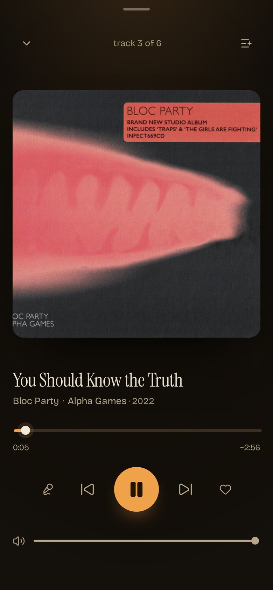
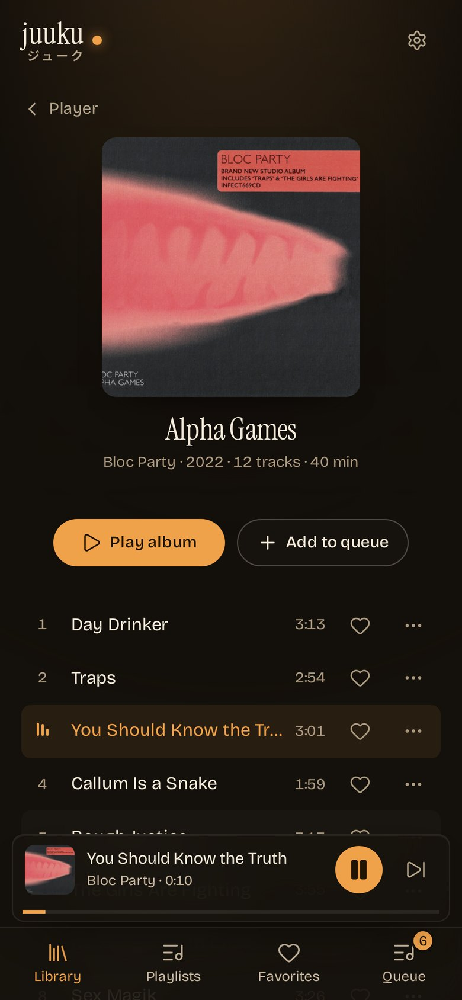

# Juuku <sub>ジューク</sub>


*Juuku* is a jukebox with the middle knocked out — `ジューク` is how Japanese shortens `ジュークボックス`.

Remote control for [Navidrome](https://www.navidrome.org/)'s **jukebox mode**: browse the library, queue music, skip, pause, favorite and set the volume on the box that actually has the speakers, from any browser on the network.

Navidrome's own web UI cannot drive the jukebox — the feature is only reachable through the Subsonic `jukeboxControl` endpoint. Juuku is that remote.


<p align="center">
  
  
  
</p>

## Run it

```sh
docker run -d --name juuku -p 3101:3101 --read-only --cap-drop ALL \
  -e NAVIDROME_URL=http://navidrome:4533 -e NAVIDROME_USER=juuku -e NAVIDROME_PASSWORD=… \
  ghcr.io/nomorenamesstudio/juuku:latest
```

Then open `http://<host>:3101` on the phone. `deploy/compose.yml` is the fuller
version (read-only rootfs, no capabilities, healthcheck), and
[docs/SETUP.md](docs/SETUP.md) covers the rest, including
[running it behind a path prefix](docs/SETUP.md#behind-a-path-prefix-tailscale-a-reverse-proxy-subpath).

### Settings

Two different passwords, and they are not interchangeable:

| variable | what it is |
|---|---|
| `NAVIDROME_URL` | the Navidrome that plays the music, e.g. `http://navidrome:4533` |
| `NAVIDROME_USER` | the Navidrome account Juuku signs in as — a normal, non-admin one is enough |
| `NAVIDROME_PASSWORD` | **that** account's password. Used by the server only; never sent to the browser |
| `JUUKU_PASSWORD` | optional lock on **Juuku itself**. Unset means no login at all (LAN default). Set it and the browser asks once, for 30 days |
| `HOST` / `PORT` | where the app listens inside the container, `0.0.0.0:3101` |

So `NAVIDROME_PASSWORD` is how the box talks to the music server; `JUUKU_PASSWORD`
is what stops someone else on the network from queueing their own taste.

[SECURITY.md](SECURITY.md) says the rest — it is a remote for the room, not a
website.

## What it does

- **Library** — album grid with paging, artist list, and one search across songs, albums and artists. Tapping a track queues it; ▶ plays it now.
- **Player** — a full-screen player that minimizes to a bottom bar: artwork, scrubber (seeks inside the current track), transport, volume, favorite.
- **Queue** — its own view, opened when you want it: skip to an entry, remove one, shuffle, or clear the lot.
- **Favorites** — the heart writes to a `Favorites` playlist in Navidrome, so other clients see it too.
- **Lyrics** — synced from the track's embedded `.lrc`/`LYRICS` tag through Navidrome, falling back to [LRCLIB](https://lrclib.net/) when a track has none.

Works on a phone first and gets a sidebar on wide screens, and installs to a home
screen as a PWA — [that needs HTTPS, which is easy on a private network](docs/SETUP.md#installing-it-as-a-pwa-and-why-https-is-worth-it).

## Quick start

```sh
npm install
./scripts/sandbox-up.sh     # throwaway Navidrome on :4533 (albums from sandbox/music)
./scripts/audio-dev.sh      # jukebox audio -> your speakers
npm run dev                 # api :3101 + web :3100
```

Open <http://127.0.0.1:3100>. The sandbox needs albums first: drop a few into
`sandbox/music`, then run `./scripts/sandbox-up.sh` again. Everything else — Docker,
a phone on the LAN, credentials — is in [docs/SETUP.md](docs/SETUP.md).

`npm run dev` runs two processes: the API server (`server/`, holds the Subsonic credentials) and Vite. `npm run build && npm start` serves the built app and the API from `:3101` alone.

## How it talks to Navidrome

Browser → Juuku API → Subsonic `/rest/jukeboxControl` → Navidrome → `mpv` on that host.

- Credentials stay server-side; the browser only sees Juuku's own JSON.
- Auth is Subsonic salted token (`t=md5(password + salt)`), so the password never travels.
- There is no push channel in the Subsonic API, so the UI polls `/api/state` once a second.
- One queue, one device: Navidrome's jukebox has a single global playback queue. `Jukebox.AdminOnly` decides who may drive it.

See [docs/ARCHITECTURE.md](docs/ARCHITECTURE.md) for the decisions and [docs/API.md](docs/API.md) for the exposed surface.

## Docs

| | |
|---|---|
| [Setup](docs/SETUP.md) | sandbox, Docker, phone testing, credentials, traps |
| [Setup → path prefix](docs/SETUP.md#behind-a-path-prefix-tailscale-a-reverse-proxy-subpath) | serving it at `/juuku` behind `tailscale serve` or any proxy subpath |
| [Setup → PWA](docs/SETUP.md#installing-it-as-a-pwa-and-why-https-is-worth-it) | home-screen install, and why HTTPS unlocks the rest |
| [Architecture](docs/ARCHITECTURE.md) | how jukebox polling, repeat and the queue model work |
| [API](docs/API.md) | the HTTP surface the UI talks to |
| [Security](SECURITY.md) | threat model, the no-login default, reverse-proxy recipe |
| [Changelog](docs/CHANGELOG.md) | dated entries |

## Configuration

Copy `.env.example` to `.env` and point it at the Navidrome you want to control:

| Variable | Default | Meaning |
| --- | --- | --- |
| `NAVIDROME_URL` | `http://127.0.0.1:4533` | Navidrome base URL |
| `NAVIDROME_USER` | `admin` | User with jukebox permission |
| `NAVIDROME_PASSWORD` | `juuku` | That user's password (the sandbox default) |
| `PORT` | `3101` | Juuku API port |

## Layout

```
server/          API + Subsonic client (plain ESM Node, no build step)
src/             React UI (Vite + TS): views/, rows, player, mini player
src/views/       Library, AlbumView, ArtistView, QueueView, FavoritesView, PlayerView
public/fonts/    Bricolage Grotesque + Instrument Serif (SIL OFL, licenses alongside)
sandbox/         throwaway music/data mount points for the dev instance
scripts/         sandbox-up.sh — compose + seed music + create admin + scan
                 audio-dev.sh — route the container's mpv to your speakers
docker-compose.yml   the throwaway Navidrome with jukebox enabled
docs/            INDEX, API, ARCHITECTURE, SETUP, CHANGELOG
```

## Support

Free, MIT, no telemetry, no accounts. If Juuku earns a place in your setup:
[buymeacoffee.com/nomorenames](https://buymeacoffee.com/nomorenames).

## License

MIT — see [LICENSE](LICENSE).

## Built with AI

Hand-written and AI-enhanced. The specification, decisions and review are mine; the implementation was drafted with DeepSeek V4.1 Flash in DeepSeek Harness. The commit history and [docs/CHANGELOG.md](docs/CHANGELOG.md) show what landed when.
