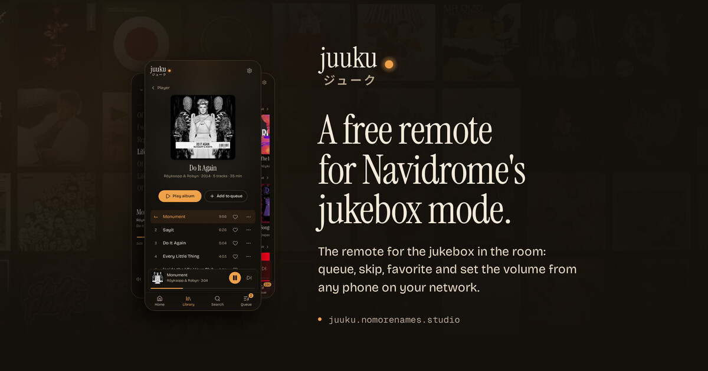
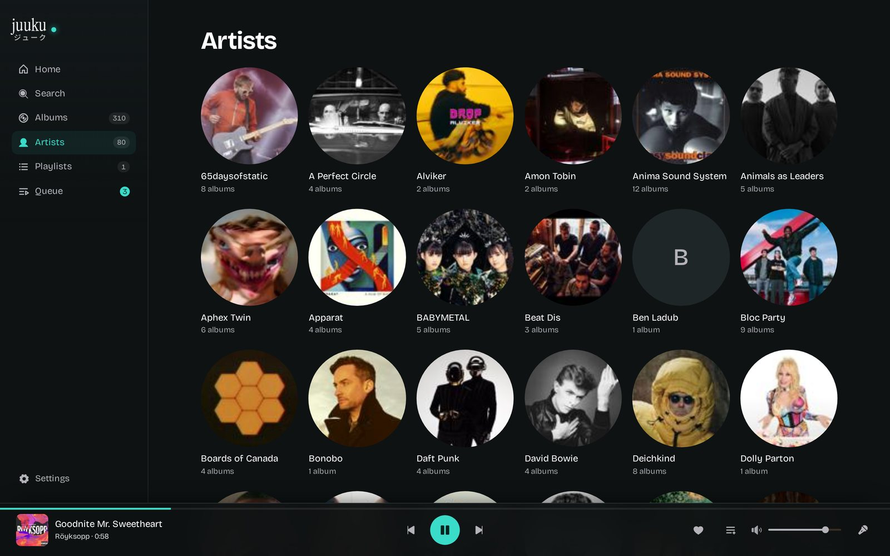
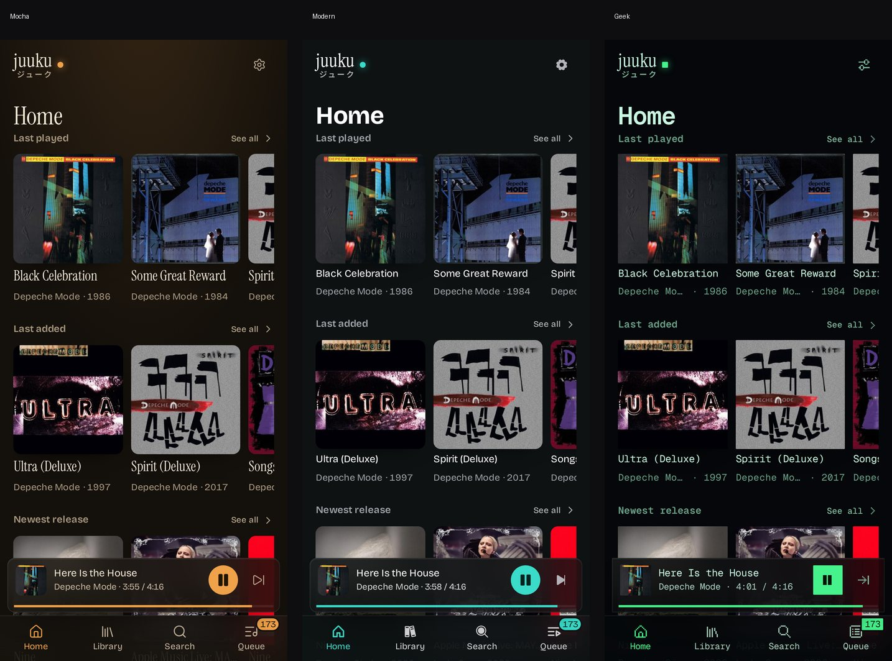

# Juuku — A Free, Open-Source Remote for Navidrome's Jukebox Mode

[](LICENSE)
[](#contributing)
[](src/)
[](server/)
[](https://github.com/nomorenamesstudio/juuku/actions/workflows/test.yml)



A free, open-source remote for [Navidrome](https://www.navidrome.org/)'s jukebox
mode that turns any browser on your network into the remote for the machine with the
speakers — and gives you a real library, queue and player instead of a raw Subsonic
endpoint.

*Juuku* (ジューク) is how Japanese shortens ジュークボックス, the jukebox.

## Why this exists

Navidrome can drive `mpv` on its own host, but its web UI has no way to reach that
feature: jukebox control only exists behind the Subsonic `jukeboxControl` endpoint. So
the music plays in the room and the only way to change it is to walk over to that
machine. Juuku is the remote that should have come in the box.

## What you get

| | |
|---|---|
| **Library** | Album grid with paging, artist list, one search across songs, albums and artists. Tapping a track queues it, ▶ plays it now. |
| **Player** | Full-screen player that minimizes to a bar: artwork, scrubber that seeks inside the track, transport, volume, favorite. |
| **Queue** | Its own view: skip to an entry, remove one, shuffle, clear the lot. It follows the playing track by itself. |
| **Favorites** | The heart writes to a `Favorites` playlist in Navidrome, so your other clients see the same list. |
| **Lyrics** | Synced from the track's embedded `.lrc`/`LYRICS` tag through Navidrome, falling back to [LRCLIB](https://lrclib.net/) when a track has none. |
| **Home** | What played last — albums and playlists — plus last added, newest release and daily picks you can re-roll, from your own library. |
| **Scrobbling** | Jukebox playback reaches Last.fm and ListenBrainz through Navidrome's own scrobbler, so the room's plays count too. No keys to paste here. |
| **Three themes** | Mocha (amber, serif), Modern (turquoise, sans) and Geek (green mono, pixel icons). Same layout, same data. |
| **Phone first** | Sidebar on a wide screen, tab bar on a phone, installs to the home screen as a PWA. |
| **One command** | A single Docker container, uid 1000, read-only root filesystem, no capabilities. |



Three themes, one layout — Mocha, Modern and Geek differ in color, type and icons, not
in what they show:



The same themes, the same screenshots and a short FAQ live on the landing page:
<https://juuku.nomorenames.studio> ([source](site/)).

## Quick start

1. Point one of these at your Navidrome:

```sh
docker run -d --name juuku -p 3101:3101 --read-only --cap-drop ALL \
  -e NAVIDROME_URL=http://navidrome:4533 -e NAVIDROME_USER=juuku \
  -e NAVIDROME_PASSWORD=… ghcr.io/nomorenamesstudio/juuku:latest
```

2. Open `http://<host>:3101` on your phone and queue something.

`deploy/compose.yml` is the fuller version (data volume, healthcheck,
`no-new-privileges`), and [docs/SETUP.md](docs/SETUP.md) covers the rest, including
[running it behind a path prefix](docs/SETUP.md#behind-a-path-prefix-tailscale-a-reverse-proxy-subpath).

### Two passwords, not interchangeable

| variable | what it is |
|---|---|
| `NAVIDROME_URL` | the Navidrome that plays the music, e.g. `http://navidrome:4533` |
| `NAVIDROME_USER` | the Navidrome account Juuku signs in as |
| `NAVIDROME_PASSWORD` | **that** account's password. Server-side only, never sent to the browser |
| `JUUKU_PASSWORD` | optional lock on Juuku itself. Unset means no login at all (the LAN default) |
| `JUUKU_TRUST_PROXY` | only behind a reverse proxy: a hop count (`1`) or `loopback` |

Navidrome defaults `Jukebox.AdminOnly` to true, so the Juuku account has to be an admin
unless you set `ND_JUKEBOX_ADMINONLY=false` on the Navidrome side. That trade, and the
rest of the threat model, is [SECURITY.md](SECURITY.md) — this is a remote for the
room, not a website.

## How it works

```
phone / laptop        juuku (Node)              navidrome              the room
   browser  ──HTTP──▶  server + built UI  ──Subsonic──▶  jukeboxControl ──▶  mpv ──▶ speakers
```

- **Credentials stay on the server.** The browser only ever sees Juuku's own JSON; the
  Subsonic call signs in with a salted token (`t=md5(password + salt)`).
- **One poll target.** `/api/state` returns queue and status together, once a second,
  cached for a moment on the server so three devices do not mean three upstream calls.
- **One queue, one room.** Navidrome's jukebox has a single global queue and a single
  set of speakers. That is the point.
- **It heals players.** Navidrome cannot always reap a dead `mpv`; Settings → *Restart
  playback* quits the leftovers over their own IPC sockets, then rebuilds the queue.
  Needs `JUUKU_MPV_SOCKETS` and matching uids, never root.

See [docs/ARCHITECTURE.md](docs/ARCHITECTURE.md) for the decisions and
[docs/API.md](docs/API.md) for the exposed surface.

## FAQ

**Do I need a Navidrome admin account?** By default yes, because Navidrome only lets
admins drive the jukebox. Set `ND_JUKEBOX_ADMINONLY=false` and a plain account works.

**Does the phone play the music?** No. `mpv` runs on the Navidrome host, next to the
speakers. The phone is only the remote, which is why it works from the sofa.

**Is it really free?** MIT, no accounts, no telemetry, no license server, no paid tier.

**Why no AI?** There is no model in the runtime: no API key, no tokens, no per-request
cost. (AI did help build it — see [Built with AI](#built-with-ai).)

**Where do my settings go?** Three small JSON files in the data directory on your own
box: preferences, the recent log and the last volume. Nothing leaves the network.

**Does it need HTTPS?** Only for the home-screen install; over plain HTTP it works. A
tailnet and `tailscale serve` is the easy way — see
[docs/SETUP.md](docs/SETUP.md#installing-it-as-a-pwa-and-why-https-is-worth-it).

**Can I run it without Docker?** Yes: `npm install && npm run build && npm start`. The
dev setup is below.

**Is there an API?** The UI talks to one small JSON API, documented in
[docs/API.md](docs/API.md).

## Development

```sh
npm install
./scripts/sandbox-up.sh     # throwaway Navidrome on :4533 (albums from sandbox/music)
./scripts/audio-dev.sh      # jukebox audio -> your speakers
npm run dev                 # api :3101 + web :3100
```

Open <http://127.0.0.1:3100>. Drop a few albums into `sandbox/music` and re-run
`./scripts/sandbox-up.sh` if the sandbox is empty.

```
server/              API + Subsonic client (plain ESM Node, no build step)
src/                 React UI (Vite + TS): views/, rows, player, mini player
src/views/           Library, Album, Artist, Playlist, Queue, Favorites, Player, Settings
public/fonts/        Bricolage Grotesque, Instrument Serif, Geist Mono (SIL OFL)
sandbox/             throwaway music and data for the dev instance
scripts/             sandbox-up.sh, audio-dev.sh
docker-compose.yml   the throwaway Navidrome with jukebox enabled
docs/                INDEX, API, ARCHITECTURE, SETUP, CHANGELOG
site/                the landing page (GitHub Pages), static, no build step
```

## Docs

| | |
|---|---|
| [Setup](docs/SETUP.md) | sandbox, Docker, phone testing, credentials, traps |
| [Architecture](docs/ARCHITECTURE.md) | polling, repeat, the queue model, player healing |
| [API](docs/API.md) | the HTTP surface the UI talks to |
| [Security](SECURITY.md) | threat model, the no-login default, reverse-proxy recipe |
| [Changelog](docs/CHANGELOG.md) | dated entries, tagged Feature / Fix / Break |

## Contributing

1. Open an issue first for anything bigger than a typo, so we agree on the shape.
2. Fork, branch, and keep the change to the thing you named — this is a remote, not a
   media server.
3. Run `npm test` and `npm run build` before the PR. Plain-spoken review, no ceremony.

## License

MIT — see [LICENSE](LICENSE). Bundled assets keep their own licenses: Bricolage
Grotesque, Instrument Serif and Geist Mono are SIL OFL (licenses in `public/fonts/`),
the geek icons are [Pixelarticons](https://github.com/halfmage/pixelarticons) by Gerrit
Halfmann (MIT) and the modern icons are [Phosphor](https://phosphoricons.com) (MIT).

## Built with AI

Hand-written and AI-enhanced. The specification, the decisions and the review are mine;
the implementation was drafted with DeepSeek V4.1 Flash in DeepSeek Harness. The commit
history and [docs/CHANGELOG.md](docs/CHANGELOG.md) show what landed when.

## Support

Free, MIT, no telemetry, no accounts. If Juuku earns a place in your setup:
[buymeacoffee.com/nomorenames](https://buymeacoffee.com/nomorenames).

[](https://github.com/nomorenamesstudio/juuku/stargazers)

Built by [K](https://github.com/nomorenamesstudio) | [nomorenames.studio](https://nomorenames.studio)
